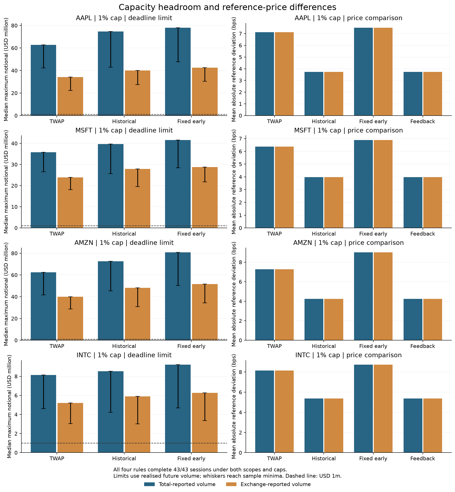

# Execution Timing Lab

How much of an order can a trading schedule finish before the deadline?

This Python study compares four ways to split a large buy order through the day. It separates two problems: too little total capacity, and releasing the order too late to use capacity that was available earlier.

## Stock experiment

**At USD 1 million, every method completed on every test date in the model. Volume feedback made no change to the historical schedule.** The more complex rule did not add value in this sample.

The data contains EBAY and LULU minute bars from 4 January to 2 March 2021: 40 sessions per stock, with the first 20 used as history. The remaining 20 dates are evaluated using a rolling, strictly prior 20-session window. The two stocks and dates were fixed before running the comparisons, based on the available public sample rather than performance.

- **TWAP:** release equal quantities every five minutes.
- **Historical:** follow the average intraday volume shares of the previous 20 sessions.
- **Fixed early:** release 10% immediately and follow the historical plan for the rest.
- **Feedback:** advance the historical plan if past intraday volume suggests insufficient later capacity.

Each method buys the same share quantity, initially worth USD 1m. Eligible shares fill at a historical five-minute reference price, up to an assumed 1% or 5% of reported volume. Unfilled shares carry forward. This is a hypothetical execution model, not a record of live trades.

## Why the volume field matters

The source separates exchange-reported volume (`Volume`) from FINRA/TRF volume (`FinraVolume`); `TotalVolume` is their sum. All 31,200 selected minute rows passed coverage and volume-identity checks. A zero-volume minute is kept; a missing minute is not replaced with zero.

The same release path is replayed with two capacity definitions: a percentage of Total volume, or a percentage of exchange-only volume. Both runs retain the same Total-field prices and benchmark. Only the capacity assumption changes. This does not model venue routing or claim that reported volume is available to our order.

At both caps, all 20 dates complete for every method and scope. At 1%, mean absolute distance from the common selected-window VWAP is:

| Capacity definition | Stock | TWAP | Historical | Fixed early | Feedback |
|---|---|---:|---:|---:|---:|
| Total | EBAY | 11.25 bp | 10.84 bp | 13.58 bp | 10.84 bp |
| Exchange only | EBAY | 11.90 bp | 11.08 bp | 13.18 bp | 11.08 bp |
| Total | LULU | 8.42 bp | 8.37 bp | 12.47 bp | 8.37 bp |
| Exchange only | LULU | 8.70 bp | 8.22 bp | 12.32 bp | 8.22 bp |

One basis point is 0.01%. Smaller absolute distance means closer benchmark tracking, not necessarily a lower buy price. These small-sample averages do not establish a better future strategy. Fixed early release tracked the benchmark less closely here; feedback was identical to historical.

## A capacity check without a parameter search

After the first run, a mathematical diagnostic was added: how large could a **fixed fractional schedule** have been before it left shares unfilled?

For every suffix of the day, the quantity still to be released must fit within the remaining capacity. If `r[j-1]` is the fraction released before bucket j, with `r[-1] = 0`:

```
Q_max = min_j(cap * sum(volume[j:]) / (1 - r[j-1]))
```

Ignore zero denominators. The first suffix is the whole-day capacity bound; later suffixes detect capacity lost by waiting too long. This applies to TWAP, historical and fixed early. Feedback is excluded because its fractions change with order size.

A three-bucket example: available capacity is 50, 20 and 10 shares. An equal release schedule can finish at most 30 shares, even though total capacity is 80. At Q = 60 it releases 20 per bucket and fills 20, 20, 10, leaving 10 unfilled.

This calculation uses realised future volume. It is a **retrospective diagnostic**, not a size recommendation known before trading. It was added after seeing the USD 1m results; the original size and comparisons were kept unchanged.

For the historical schedule at the 1% cap, the median deadline-compatible notional was:

| Stock | Total-volume capacity | Exchange-only capacity | Lowest exchange-only limit |
|---|---:|---:|---:|
| EBAY | USD 2.86m | USD 1.96m | USD 1.13m |
| LULU | USD 2.87m | USD 2.03m | USD 1.22m |

Both definitions accommodate USD 1m on every date, but they leave different headroom. Fixed early release increases the capacity limit while tracking the benchmark less closely in this sample. That is a trade-off, not a universal strategy ranking.



## Reproduce

First obtain the stock minute files from [AlgoSeek's book companion data](https://algoseek.com/ml-for-trading/) under the applicable terms. Put the 80 files in `data/equities/` as `EBAY_20210104.csv`, `LULU_20210104.csv`, etc. The required dates are in `sessions()` in [study/equity.py](../study/equity.py). Raw stock data is not bundled or redistributed.

Then run the commands below. The tests use synthetic data and can also run without the stock files. The equity command stops without writing outputs if no usable evaluation data is available.

```bash
python3 -m venv .venv
source .venv/bin/activate
python -m pip install -r requirements.txt
python -m unittest discover -s tests -q
python -m study.equity
```

The selected session is 09:30 <= minute start < 16:00, America/New_York, grouped into 78 five-minute buckets. Records assigned to 16:00 are excluded, so the benchmark is not an auction-complete full-day VWAP. Each price is weighted by its corresponding volume field. The order quantity uses the first reported trade in the opening minute, not that minute's later VWAP.

`results/equities/equity_daily.csv` contains 640 policy/cap/scope comparisons across 40 evaluated stock-days. The JSON records coverage, exclusions, exact history dates, file hashes and summaries. Tests check conservation, capacity limits, causal release decisions, missing data, zero-volume handling and the analytical boundary.

## Earlier work and source hashes

The [archive branch](https://github.com/Wanji-Jimmy/execution-timing-lab/tree/archive/before-2026-10-26-simplification) preserves the earlier BTC/ETH outputs, plot script, download manifests and original layout. Its README and protocol document that experiment. The order there is denominated in USDT, not USD; the stock and crypto samples use different years and do not establish a causal cross-market comparison.

The shared release, replay and data checks remain in `study/` with their tests. The full sequence of design decisions and amendments is in [protocol.md](protocol.md).

The three saved stock result files were retained byte for byte during the layout cleanup on 26 October 2026. Their source hashes identify the original evaluation files, not the current reorganised files. Imports, paths and documentation have since changed; the saved results were not rerun or relabelled. A new run records the current source paths and hashes.

## Limits and references

Historical bar prices do not reveal our queue position, spread paid, fees, market impact or actual fills. Participation caps are scenarios. Continuous share quantities are an approximation. The stock sample has only two names and 20 evaluation dates each; the study establishes neither profit nor net execution savings. Issuer filings were checked for splits in the sample window, but the downloaded bundle's retrospective adjustment policy is not independently certified.

- [AlgoSeek field definitions](https://algoseek.com/docs/rest-api/reference/endpoint-v-1-data-us-equity-taq-1-min-identifier-get) and [data licensing](https://algoseek.com/licensing-faq/).
- [Binance public archives](https://github.com/binance/binance-public-data) and their [published data terms](https://github.com/binance/binance-public-data/blob/master/TERMS_AND_CONDITIONS.md).
- [CALM](https://github.com/Shivesh777/CALM) motivated comparing forecast quality with execution outcomes; its online aggregation algorithm is not implemented here.
- [Busseti–Boyd](https://stanford.edu/~boyd/papers/vwap_opt_exec.html) and [Markov–Mazur–Saltz](https://arxiv.org/html/1409.1441v1) inform the scheduling question. This rule does not reproduce their optimizers.
- [hftbacktest's fill assumptions](https://hftbacktest.readthedocs.io/en/latest/order_fill.html) inform the replay limitations; no hftbacktest code is used.

The schedules and capacity identities are established ideas. The work here is the controlled comparison, data checks and analysis of when the assumptions matter.
